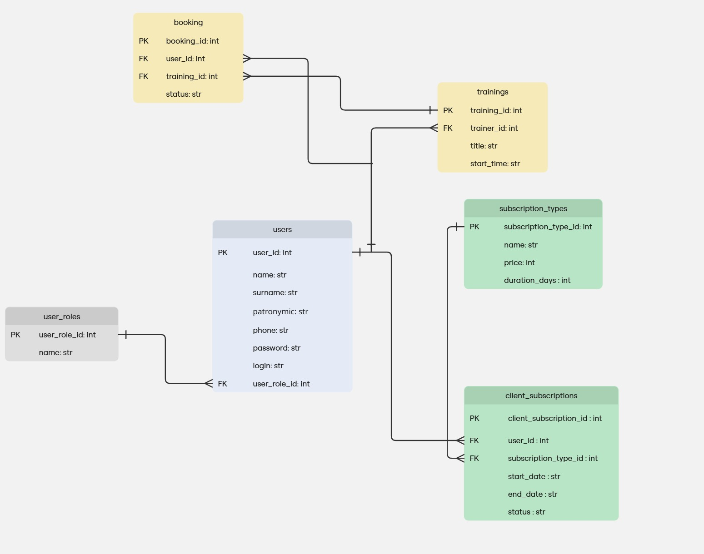

# PulseFit

Pulsefit — консольное приложение для учёта клиентов в фитнес-клубе и предоставляемых им услуг. Проект предназначен для автоматизации учёта клиентов, абонементов и посещений фитнес-клуба.


## Возможности
В проекте предусмотрены следующие основные возможности:

- хранение информации о клиентах;
- добавление новых клиентов;
- изменение информации о клиентах;
- поиск информации о клиентах;
- оформление абонементов;
- просмотр информации об абонементах;
- проверка срока действия абонемента;
- регистрация посещений;
- просмотр истории посещений;
- просмотр клиентом информации о своём абонементе и посещениях.

## Предметная область
Клиент: ФИО, дата рождения, номер телефона, адрес электронной почты, дата регистрации.

Абонемент: вид абонемента, дата начала действия, дата окончания действия, стоимость.

Посещение: клиент, дата посещения.

Задача системы — удобный учёт клиентов фитнес-клуба, отслеживание их абонементов и посещений, а также снижение вероятности ошибок при работе с данными.

## Пользователи и роли

| Роль | Возможности |
|---|---|
| **Администратор** | Добавляет и изменяет информацию о клиентах, оформляет абонементы, регистрирует посещения, проверяет срок действия абонементов |
| **Клиент** | Просматривает информацию о своём абонементе, проверяет срок его действия, узнаёт расписание занятий и просматривает свою статистику посещений |

## Структура проекта

```text
Pulsefit/
│
├── .vscode/                    # Настройки Visual Studio Code
│   └── launch.json             # Конфигурация запуска и отладки
│ 
├── docs/                                # Документация проекта
│   │               
│   ├── usecase.puml # PlantUML UseCase диаграммы   
│   ├── Adding a new client.jpg  # Блок-схема Добавление нового клиента
│   ├── Applying for a subscription.jpg # Блок-схема Оформление абонемента
│   ├── Myusecase.png # UseCase диаграмма
│   └── process of registering.jpg  # Блок-схема процесса регистрации посещения клуба
│
├── src/                                 # Исходный код приложения
│   │
│   └── Pulsefit/                        # Основной пакет приложения
│       │
│       ├── __init__.py                  # Инициализация Python-пакета
│       ├── main.py                      # Точка входа в приложение
│       ├── auth.py                      # Логика авторизации
│       ├── menu.py                      # Консольное меню
│       │
│       ├── database/                    # Работа с базой данных
│       │
│       ├── models/                      # Модели предметной области
│       │
│       ├── repositories/                # Доступ к данным
│       │
│       └── services/                    # Бизнес-логика приложения
│
├── tests/                        # Автоматизированные тесты
|    ├── __init__.py
|    └── test_main.py
|
├── .gitignore                    # Исключения для Git
├── README.md                     # Документация проекта
└── requirements.txt              # Список зависимостей проекта

```
### Схема базы данных (ERD)



### Основные компоненты

#### `main.py`

Точка входа в приложение. Выполняет инициализацию необходимых компонентов и запускает программу.

#### `menu.py`

Содержит логику взаимодействия с пользователем через консольное меню.

#### `auth.py`

Отвечает за регистрацию и авторизацию пользователей.

#### `models`

Содержит модели основных сущностей предметной области, включая пользователей, заявки, сотрудников техподдержки.

#### `repositories`

Содержит компоненты, отвечающие за получение, добавление, изменение и удаление данных.

#### `services`

Содержит бизнес-логику приложения и обеспечивает взаимодействие между пользовательским интерфейсом и слоем доступа к данным.

#### `database`

Содержит компоненты, необходимые для работы с базой данных и её инициализации.

## Установка

### 1. Клонирование репозитория

```bash
git clone <repository-url>
cd pulsefit
```

### 2. Создание виртуального окружения

```bash
python -m venv .venv
```

### 3. Активация виртуального окружения

Windows PowerShell:

```powershell
.venv\Scripts\Activate.ps1
```

Windows Command Prompt:

```cmd
.venv\Scripts\activate.bat
```

Linux и macOS:

```bash
source .venv/bin/activate
```

### 4. Установка зависимостей

```bash
pip install -r requirements.txt
```

## Запуск приложения

Из корневой папки проекта выполните:

```bash
python -m src.pulsefit.main
```

После запуска в консоли будет отображено главное меню приложения.

```text
===== Техническая поддержка =====
1. Вход
2. Регистрация пользователя
0. Выход
```

Пользователь может выбрать необходимое действие, введя соответствующий номер.

## Работа в Visual Studio Code

Для запуска проекта в Visual Studio Code необходимо выбрать интерпретатор Python из виртуального окружения:

```text
.venv\Scripts\python.exe
```

Конфигурация запуска находится в файле:

```text
.vscode/launch.json
```

Проект запускается как Python-модуль:

```text
src.pulsefit.main
```

Это позволяет корректно использовать пакетную структуру проекта и абсолютные импорты.

## Используемые технологии

* Python 3.14;
* Git;
* Visual Studio Code;
* виртуальное окружение Python (`venv`).

## Разработка

Исходный код проекта располагается в каталоге:

```text
src/pulsefit/
```

При разработке рекомендуется соблюдать следующую организацию кода:

* модели предметной области размещать в `models`;
* работу с базой данных размещать в `repositories`;
* бизнес-логику размещать в `services`;
* код пользовательского интерфейса размещать отдельно от бизнес-логики.

## Лицензия

Проект является учебным проектом. 